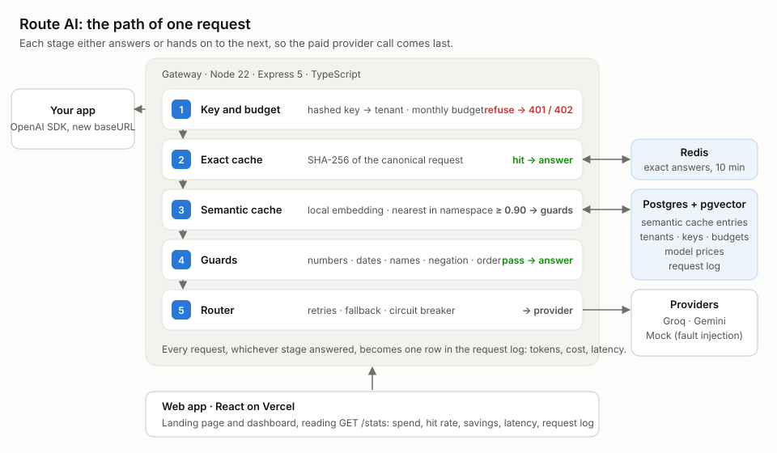

# Route AI

An OpenAI-compatible LLM gateway. Point any OpenAI client at it and get semantic caching, automatic provider fallback, per-tenant budgets and the cost of every token recorded, without changing anything else in your code.

**Live:** https://routee-ai.vercel.app · [Dashboard](https://routee-ai.vercel.app/dashboard)

## About

Every app that calls an LLM pays for the same questions over and over, and breaks when its one provider has a bad day. Route AI sits in between. Apps change a single line, their `baseURL`, and every request then goes through a pipeline that answers from cache whenever it safely can, and only pays a provider when it has to.

The interesting part is the **semantic cache**: "How do I reset my password?" and "How can I reset my password?" should get the same stored answer, but "What is 2+2?" and "What is 2+3?" must not, even though an embedding model sees them as almost identical. Route AI measures where that line is instead of guessing, and adds cheap text checks for the cases the model gets wrong.

| On a 50-request workload through Groq | |
| --- | --- |
| Served from cache | **56%** of cacheable requests |
| Spend | **50% lower** than without the cache |
| Speed on a cache hit | **13× faster** (56 ms vs 718 ms) |
| Wrong cached answers | cut **from 30 to 3** by the guards |

## Features

- **Drop-in OpenAI API.** `POST /v1/chat/completions` with streaming. Works with the official OpenAI SDKs and anything that speaks the same format.
- **Exact cache.** Identical requests are answered from Redis in milliseconds. Requests are normalised first, so key order and stray whitespace don't cause misses.
- **Semantic cache.** Reworded questions are matched by meaning with a local embedding model and pgvector, but only within the same tenant, model, system prompt, tools and conversation, so a similar question under a different setup never gets the wrong answer.
- **Guards.** Before a similar answer is reused, numbers, dates, names, negations ("working" vs "not working") and word order must agree.
- **Provider fallback.** Logical model names (`fast`, `smart`, `balanced`) map to an ordered list of providers. Failures are retried with backoff, then passed to the next provider.
- **Circuit breaker.** A provider that keeps failing is skipped for 30 seconds instead of slowing every request down.
- **Tenants, keys and budgets.** API keys are shown once and stored as hashes. Each tenant has a monthly budget that is enforced before any money is spent.
- **Cost tracking.** Every request is priced in micro-dollars from a price table with effective dates, including hidden reasoning tokens.
- **Dashboard.** Spend, hit rate, savings, cached vs uncached latency, and a filterable request log with full detail for every request.
- **Mock provider.** Fails on demand (rate limits, server errors, slow starts, broken streams) so resilience can be tested without spending real quota.

## Results

The similarity threshold was chosen by measurement: 200 hand-labelled question pairs, 94 of them written to be tricky, tested at every threshold from 0.80 to 0.99.


Some of the near-identical questions the embedding model wanted to treat as the same, and what the guards do with them:

| Similarity | Pair | Guard |
| --- | --- | --- |
| 0.992 | convert a **string to a number** / a **number to a string** | refused: direction swapped |
| 0.984 | is it **legal** / **illegal** to record a call | refused: opposite meaning |
| 0.972 | why is my code **working** / **not working** | refused: negated |
| 0.969 | schedule it for **next week** / **this week** | refused: dates differ |

Full study: [evals/results.md](evals/results.md).

## Stack

| | |
| --- | --- |
| Gateway | Node 22, TypeScript, Express 5, Zod |
| Data | PostgreSQL with pgvector, Drizzle ORM, Redis |
| AI | Groq and Gemini as providers, MiniLM embeddings run locally with transformers.js |
| Web app | React 19, Vite, React Router, Recharts |
| Hosting | Vercel (web), Render (gateway), Neon (Postgres), Upstash (Redis), all on free tiers |

## Architecture



Each request passes through five stages, cheapest first: **key and budget → exact cache → semantic cache → guards → router**. Each stage either answers or hands on, so the paid provider call happens only when nothing cheaper can answer. Every request, whichever stage answered it, is logged with tokens, cost and latency.

The web app never calls the gateway cross-origin. `client/vercel.json` rewrites `/v1`, `/stats` and `/health` to the gateway, so the browser only ever talks to one address:

```
browser ──► Vercel (web app) ──► (rewrite, server-side) ──► Render (gateway) ──► Groq / Gemini
```

## Layout

```
src/            the gateway
  routes/       /v1/chat/completions and /stats
  services/     caches, namespace, guards, router, analytics
  providers/    Groq, Gemini and mock adapters
  middleware/   API keys, budgets, errors
client/         React web app: landing page and dashboard
migrations/     database migrations
evals/          the 200 labelled pairs and the threshold sweep
docs/           design reference, diagram and charts
```

## Setup

Requires Node 22+, Docker, and free API keys from [Groq](https://console.groq.com) and [Google AI Studio](https://aistudio.google.com). The built-in `mock` model works without any key.

```
git clone https://github.com/NishaM2/Route-AI.git
cd Route-AI
npm install
cp .env.example .env
docker compose up -d --wait
npm run db:migrate
npm run tenant:create -- "My App" 1.00
```

The last command prints an API key once. Save it.

`.env`

| Variable | Required | Notes |
| --- | --- | --- |
| `DATABASE_URL` | yes | Postgres with pgvector. Docker provides one on port 5433 |
| `GROQ_API_KEY` | yes | Free from Groq |
| `GEMINI_API_KEY` | yes | Free from Google AI Studio |
| `REDIS_URL` | no | Defaults to `redis://localhost:6379`. Without Redis the gateway still works, just without the exact cache |
| `PORT` | no | Defaults to 3000 |
| `ADMIN_TOKEN` | no | Protects the dashboard stats |
| `STATS_PUBLIC` | no | `true` makes the dashboard readable without a token, for a public demo |

## Running

Two terminals:

```
npm run dev
npm run web
```

The gateway listens on `:3000` and the web app on `:5173`. Then send a request with your key:

```
curl http://localhost:3000/v1/chat/completions \
  -H "Authorization: Bearer YOUR_KEY" -H "Content-Type: application/json" \
  -d '{"model": "mock", "messages": [{"role": "user", "content": "Why is the sky blue?"}]}'
```

Use `fast` instead of `mock` to go to Groq. Run `npm run traffic -- YOUR_KEY` to send 50 mixed requests so the dashboard has data to show.

## Commands

| Command | What it does |
| --- | --- |
| `npm run dev` / `npm run web` | Start the gateway / the web app |
| `npm run build` / `npm run web:build` | Production builds |
| `npm run db:migrate` | Apply database migrations |
| `npm run tenant:create -- "Name" 1.00` | Create a tenant with a monthly budget, and print its API key |
| `npm test` | Run the 79 unit tests |
| `npm run eval:sweep:guards` | Re-run the threshold study and redraw the chart |
| `npm run traffic -- KEY` | Send 50 mixed requests for demo data |
| `npm run cache:flush -- "Tenant" request.json` | Clear cached answers for one setup |

## API

| Endpoint | Purpose |
| --- | --- |
| `POST /v1/chat/completions` | OpenAI-compatible chat, streaming supported. Needs `Authorization: Bearer <key>` |
| `GET /health` | Health check |
| `GET /stats/summary` | This month's spend, hit rate, savings and median time to first token |
| `GET /stats/spend` · `/hit-rate` · `/savings` · `/latency` | Daily series for the dashboard charts |
| `GET /stats/requests` | Request log, paged, filterable by tenant, cache status and outcome |
| `GET /stats/tenants` · `/providers` | Tenant list, and each provider's circuit breaker state |

## Deployment

The web app and the gateway deploy separately, with the web app forwarding API calls to the gateway.

1. **Neon:** create a Postgres database, then run `npm run db:migrate` and `npm run tenant:create` against it by setting `DATABASE_URL` in the terminal.
2. **Upstash:** create a Redis database and copy its `rediss://` URL.
3. **Render:** deploy this repo with `render.yaml`. Set `DATABASE_URL`, `REDIS_URL`, `GROQ_API_KEY`, `GEMINI_API_KEY`, and `STATS_PUBLIC=true` for a public dashboard.
4. **Vercel:** put the Render address into `client/vercel.json`, then import the repo with **Root Directory** set to `client`.
5. **Keep it awake:** free Render services sleep after 15 minutes. An uptime monitor calling `/health` every 5 minutes prevents that.

Full step-by-step guide: [docs/design.md](docs/design.md#deploying-for-free).

## Known limitations

- **The semantic cache isn't perfect.** 3 of 115 different-meaning test pairs still match (for example "zoom in" / "zoom out"), and some genuine rewordings are refused.
- **No fallback mid-stream.** Once an answer has started streaming, a provider failure can't be handed to another provider.
- **Semantic lookups add about 85 ms** to every cache miss, for the embedding and vector search.
- **Budgets can be overshot slightly** when two requests arrive at the same moment.
- **Free hosting sleeps.** The first request after a quiet spell can take up to a minute.

## Learn more

- [docs/design.md](docs/design.md): how every part works and why
- [evals/results.md](evals/results.md): the full threshold study
- [evals/pairs.json](evals/pairs.json): the 200 labelled question pairs
